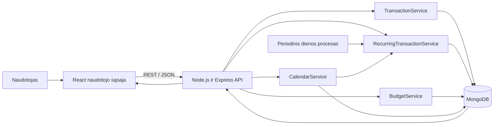

## 1. Problema ir idėja

  

**Sistema vienu sakiniu:** „Budget Tracker“ yra asmeninių finansų sistema, kurioje naudotojas gali greitai registruoti pajamas ir išlaidas, nustatyti kategorijų biudžetus, kalendoriuje matyti būsimas operacijas ir automatiškai kurti pasikartojančias operacijas pagal pasirinktas datas.

  

**Problema ir dabartinis procesas:** norint suprasti, kur išleidžiami pinigai, žmogui dažnai tenka naudoti skaičiuoklę, banko programėlę arba užrašus. Banko programėlėje matomos operacijos, tačiau ne visada galima susikurti asmenines kategorijas, planuoti konkrečius biudžetus ar vienoje vietoje matyti būsimus periodinius mokėjimus. Skaičiuoklėje kiekvieną mėnesį reikia iš naujo įrašyti nuomą, prenumeratas, interneto mokestį ir kitas pasikartojančias išlaidas. Toks procesas užima laiko, todėl duomenys dažnai pildomi nereguliariai.

  

**Nauda:** visa finansinė informacija bus vienoje vietoje, pasikartojančių mokėjimų nereikės suvedinėti iš naujo, o biudžeto perspėjimai padės pastebėti per dideles išlaidas dar nepasibaigus mėnesiui. Kalendorius leis iš anksto matyti, kuriomis dienomis numatomas atlyginimas, nuoma ar prenumeratos. Suvestinė leis palyginti faktines pajamas, išlaidas ir likutį.

  

**Naudotojai:** pagrindinis naudotojas yra studentas arba dirbantis žmogus, norintis paprastai sekti asmenines pajamas ir išlaidas. Jis registruos operacijas, kurs periodinių mokėjimų taisykles, nustatys biudžetus, kalendoriuje peržiūrės būsimas operacijas ir analizuos mėnesio suvestinę.

  

**Prielaidos:**

  

- Pirmoje versijoje sistema skirta vienam naudotojui, todėl prisijungimas ir kelių paskyrų valdymas nebus kuriami.

- Visos pinigų sumos pateikiamos eurais.

- Naudotojas pats pasirenka operacijos kategoriją.

- Pasikartojanti operacija reiškia vienodo dydžio pajamą arba išlaidą, kuri kartojasi kas savaitę, mėnesį arba metus.

- Biudžetai nustatomi konkrečiam kalendoriniam mėnesiui ir išlaidų kategorijai.

- Sistema nuskaito operacijas iš savo duomenų bazės; automatinio prisijungimo prie banko šiame etape nebus.

  

## 2. Apimtis

  

### 1. Pajamų ir išlaidų registravimas

  

- **Ką naudotojas galės atlikti:** greitai įvesti sumą, datą, kategoriją ir aprašymą, redaguoti ar pašalinti įrašą bei filtruoti operacijas.

- **Modulio tipas:** pagalbinė funkcija.

  

### 2. Pasikartojančių operacijų valdymas

  

- **Ką naudotojas galės atlikti:** sukurti savaitinę, mėnesinę ar metinę taisyklę, pagal kurią sistema automatiškai generuos operacijas nustatytomis datomis.

- **Modulio tipas:** pagrindinis modulis.

  

### 3. Kategorijų biudžetai

  

- **Ką naudotojas galės atlikti:** nustatyti mėnesio limitą, matyti panaudotą sumą, likutį ir perspėjimą pasiekus nustatytą ribą.

- **Modulio tipas:** pagrindinio modulio dalis.

  

### 4. Finansinis kalendorius

  

- **Ką naudotojas galės atlikti:** kalendoriuje matyti faktines ir būsimas planuojamas pajamas bei išlaidas, pasirinkti dieną ir peržiūrėti jos operacijas.

- **Modulio tipas:** pagalbinė funkcija.

  

### 5. Mėnesio suvestinė

  

- **Ką naudotojas galės atlikti:** matyti bendras faktines pajamas, išlaidas, balansą ir išlaidų pasiskirstymą pagal kategorijas.

- **Modulio tipas:** pagalbinė funkcija.

  

**Į kursinio darbo apimtį neįeina:** banko sąskaitų sinchronizavimas, mokėjimų atlikimas, valiutų konvertavimas, kelių naudotojų paskyros, bendras šeimos biudžetas, investicijų sekimas, čekių atpažinimas iš nuotraukų, AI finansinės konsultacijos ir mobilioji programėlė. Pirmame prototipe svarbiausia patikimai įgyvendinti operacijų, pasikartojančių datų, kalendoriaus ir biudžetų logiką.

  

## 3. Pagrindinis modulis

  

**Pavadinimas ir atsakomybė:** pasikartojančių operacijų ir biudžetų kontrolės modulis. Jis atsakingas už periodinių pajamų bei išlaidų generavimą pagal naudotojo nustatytas datas, dublikatų prevenciją, kalendoriaus būsimų įvykių apskaičiavimą, mėnesio kategorijų sumų skaičiavimą ir biudžeto būsenos nustatymą.

  

**Logika, kurią reikės projektuoti ir testuoti:** modulis turi teisingai apdoroti savaitines, mėnesines ir metines taisykles, skirtingo ilgio mėnesius, keliamuosius metus, taisyklės pakeitimus, pakartotinį generavimo paleidimą ir biudžeto ribų perėjimą. Jis taip pat turi atskirti faktines operacijas nuo būsimų planuojamų įvykių. Planuojamos operacijos matomos kalendoriuje, tačiau neįtraukiamos į faktinį balansą ar panaudotą biudžetą.

  

**Įvestis:** operacijos tipas - pajamos arba išlaidos; suma euro centais; kategorija; aprašymas; kartojimo dažnis - kas savaitę, mėnesį arba metus; pradžios data; neprivaloma pabaigos data; aktyvi arba sustabdyta būsena. Biudžeto skaičiavimui pateikiamas mėnuo, kategorija ir limitas. Konkretus pavyzdys: 650,00 Eur išlaida „Būsto nuoma“, kategorija „Būstas“, dažnis - kas mėnesį, pradžios data - 2026-10-01.

  

**Išvestis:** sukurta faktinė pajamų arba išlaidų operacija, kita numatoma pasikartojimo data, pasirinkto mėnesio kalendoriaus faktiniai ir planuojami įvykiai, biudžeto panaudota suma, procentas, likutis ir būsena arba konkretus klaidos pranešimas. Pavyzdžiui, 2026-10-01 sukuriama 650,00 Eur nuomos išlaida, o kita vykdymo data nustatoma į 2026-11-01.

  

**Veikimo eiga:**

  

1. Naudotojas sukuria pasikartojančios operacijos taisyklę.

2. Backend patikrina operacijos tipą, sumą, kategoriją, dažnį ir datas.

3. Taisyklė išsaugoma MongoDB kartu su kita vykdymo data.

4. Periodinis backend procesas kartą per dieną suranda aktyvias taisykles, kurių vykdymo data jau atėjo.

5. Sistema sukuria faktinę operaciją, prieš tai patikrinusi unikalų taisyklės ir datos derinį.

6. Pagal dažnį apskaičiuojama kita vykdymo data. Jei pasirinktos dienos mėnesyje nėra, naudojama paskutinė to mėnesio diena.

7. Sukūrus arba ranka įvedus išlaidą perskaičiuojamas atitinkamos kategorijos mėnesio biudžetas.

8. Kalendoriaus užklausoje sujungiamos faktinės operacijos ir iš aktyvių taisyklių apskaičiuoti būsimi įvykiai.

9. Frontend per REST API gauna rezultatą ir atnaujina operacijų sąrašą, kalendorių, suvestinę bei biudžeto juostą.

  

### Taisyklės arba sprendimo žingsniai

  

1. Operacijos ir biudžeto suma turi būti didesnė už nulį. Sumos saugomos sveikais euro centais, pavyzdžiui, 19,99 Eur saugoma kaip `1999`.

2. Savaitinei taisyklei pridedamos 7 dienos, mėnesinei - vienas kalendorinis mėnuo, o metinei - vieni kalendoriniai metai.

3. Jei mėnesinė operacija nustatyta 29, 30 arba 31 dieną, bet kitame mėnesyje tokios dienos nėra, ji sukuriama paskutinę to mėnesio dieną. Vėliau sistema vėl bando naudoti pradinę pasirinktą dieną.

4. Vienai pasikartojimo taisyklei tą pačią datą galima sukurti tik vieną operaciją. MongoDB naudojamas unikalus indeksas pagal `recurringRuleId` ir `occurrenceDate`.

5. Pakeitus taisyklę, jau sukurtos ankstesnių datų operacijos nekeičiamos. Nauji nustatymai taikomi tik būsimoms operacijoms.

6. Sustabdyta taisyklė naujų operacijų nekuria. Ją aktyvavęs naudotojas pasirenka, ar sukurti praleistas operacijas, ar tęsti nuo artimiausios būsimos datos.

7. Į panaudotą kategorijos biudžetą įtraukiamos tik faktinės pasirinkto mėnesio išlaidos. Pajamos ir būsimos planuojamos operacijos neįtraukiamos.

8. Kai panaudota mažiau nei 80 % limito, būsena yra normali. Nuo 80 % iki 99,99 % rodoma „Artėjama prie limito“, o nuo 100 % - „Biudžetas viršytas“.

9. Kalendoriuje faktinės ir planuojamos operacijos žymimos skirtingai. Kai ateina planuojamos operacijos data ir sukuriamas faktinis įrašas, planuojamas įvykis pakeičiamas faktiniu, todėl dublikatas nerodomas.

  

### Scenarijai būsimiems testams

  

#### Įprastas atvejis

  

- **Pradinės sąlygos ir įvestis:** aktyvi mėnesinė nuomos taisyklė: 650,00 Eur, pradžia ir kita vykdymo data - 2026-10-01.

- **Veiksmas:** 2026-10-01 paleidžiamas periodinių operacijų procesas.

- **Tikslus laukiamas rezultatas:** sukuriama viena 650,00 Eur išlaida „Būstas“, o kita vykdymo data tampa 2026-11-01.

  

#### Ribinis atvejis arba konfliktas

  

- **Pradinės sąlygos ir įvestis:** aktyvi 25,00 Eur mėnesinė prenumerata pradėta 2027-01-31. Sausio operacija jau sukurta, o `nextRunDate` yra 2027-02-28.

- **Veiksmas:** procesas 2027-02-28 paleidžiamas du kartus.

- **Tikslus laukiamas rezultatas:** sukuriama tik viena 25,00 Eur operacija su data 2027-02-28, o kita vykdymo data tampa 2027-03-31.

  

#### Klaida arba neįmanomas rezultatas

  

- **Pradinės sąlygos ir įvestis:** įvesta pasikartojanti išlaida, kurios suma `0`, pradžia 2026-10-10, o pabaiga 2026-10-01.

- **Veiksmas:** paspaudžiamas išsaugojimo mygtukas.

- **Tikslus laukiamas rezultatas:** taisyklė neišsaugoma. Rodomos klaidos, kad suma turi būti didesnė už nulį ir pabaigos data negali būti ankstesnė už pradžios datą.

  

**Jei modulis naudoja AI:** netaikoma. Pasikartojančių operacijų, kalendoriaus ir biudžetų rezultatai apskaičiuojami deterministinėmis programos taisyklėmis, todėl kiekvieną rezultatą galima paaiškinti ir tiksliai testuoti.

  

## 4. Kokybės atributas

  

**Pasirinktas atributas:** patikimumas, tiksliau - finansinių skaičiavimų ir pasikartojančių operacijų teisingumas.

  

**Kodėl svarbus šiai sistemai:** neteisinga suma, praleistas mokėjimas arba dvi vienodos automatiškai sukurtos išlaidos pateiktų klaidingą mėnesio balansą ir biudžeto būseną. Tokia sistema naudotojas negalėtų pasitikėti.

  

**Tikrinimo scenarijus ir sąlygos:** bus parengta ne mažiau kaip 40 automatinių testų. Jie apims savaitines, mėnesines ir metines taisykles, keliamuosius metus, 28-31 mėnesio dienas, pakartotinį generavimo paleidimą, taisyklės sustabdymą, biudžeto ribas, sumas su centais bei kalendoriaus faktinių ir planuojamų įvykių atskyrimą. Integraciniuose testuose bus naudojama atskira MongoDB testinė duomenų bazė.

  

**Sėkmės kriterijus:** visi automatiniai testai baigiasi sėkmingai; testiniame rinkinyje nėra nė vieno pasikartojančios operacijos dublikato; visos sumos ir likučiai iki cento sutampa su laukiamais rezultatais; netinkamos įvestys atmetamos prieš jas išsaugant; kiekvienas kalendoriaus įvykis rodomas teisingą dieną ir vienu metu nerodomas kaip faktinis bei planuojamas.

  

**Numatytas projektavimo sprendimas:** pinigų sumos saugomos sveikais centais. Pasikartojimų logika atskiriama į `RecurringTransactionService`, biudžetų skaičiavimas - į `BudgetService`, o kalendoriaus duomenų paruošimas - į `CalendarService`. MongoDB sukuriamas unikalus sudėtinis indeksas pagal taisyklės identifikatorių ir vykdymo datą.

  

**Kaip patikrinsiu vėlesniame etape:** naudosiu vienetų testus datų ir biudžetų funkcijoms, integracinius REST API testus su testine duomenų baze ir rankiniu būdu pakartosiu 3 skyriuje pateiktus scenarijus.

  

**Sprendimo kaina arba ribojimas:** reikės daugiau kodo validacijai, unikaliems indeksams ir testiniams duomenims. Sumų laikymas centais reiškia, kad frontend turi jas konvertuoti rodymui. Planuojamas kalendoriaus operacijas reikės apskaičiuoti kiekvieną kartą atidarant pasirinktą mėnesį.

  

## 5. Pradinė sistemos struktūra

  

### Paprasta schema

  

  

- **React naudotojo sąsaja:** rodo suvestinę, formas, kalendorių, biudžeto juostas ir operacijų sąrašą; surenka įvestį ir parodo klaidas.

- **Express REST API:** priima HTTP užklausas, atlieka bazinę validaciją, iškviečia reikiamą servisą ir grąžina JSON atsakymą.

- **`TransactionService`:** kuria, redaguoja, šalina ir filtruoja rankines pajamas bei išlaidas.

- **`RecurringTransactionService`:** tikrina periodines taisykles, generuoja operacijas, neleidžia dublikatų ir apskaičiuoja kitą datą.

- **`BudgetService`:** susumuoja faktines kategorijos išlaidas ir apskaičiuoja biudžeto būseną.

- **`CalendarService`:** sujungia faktines operacijas su iš aktyvių taisyklių apskaičiuotais būsimais įvykiais.

- **Periodinis procesas:** kartą per dieną inicijuoja aktyvių taisyklių patikrą.

- **MongoDB:** saugo operacijas, kategorijas, pasikartojimo taisykles ir mėnesio biudžetus.

  

**Pradinis duomenų modelis:** `transactions` kolekcijoje bus saugomas operacijos tipas, suma centais, kategorija, aprašymas, data ir pasikartojimo taisyklės identifikatorius. `recurringRules` kolekcijoje bus saugomas dažnis, pradžios, pabaigos bei kita vykdymo data ir aktyvumo būsena. `budgets` kolekcijoje bus saugomas mėnuo, kategorija ir limitas centais. Kalendoriaus įvykiams atskira kolekcija nereikalinga: faktiniai įvykiai gaunami iš `transactions`, o būsimi įvykiai apskaičiuojami iš `recurringRules`.

**Planuojamos technologijos ir pasirinkimo priežastys:**

  

- **React ir JavaScript** - interaktyviai naudotojo sąsajai, greito įvedimo formai, filtrams ir suvestinėms.

- **React Router** - suvestinės, operacijų, kalendoriaus, biudžetų ir periodinių taisyklių puslapiams.

- **`react-big-calendar` arba analogiškas komponentas** - mėnesio kalendoriui ir operacijų įvykiams atvaizduoti.

- **Node.js ir Express** - REST API bei verslo logikai, naudojant tą pačią JavaScript ekosistemą kaip frontend.

- **MongoDB ir Mongoose** - duomenims saugoti, modelių validacijai ir unikaliems indeksams.

- **`date-fns`** - kalendorinių datų skaičiavimams ir formatavimui.

- **Recharts arba Chart.js** - pajamų, išlaidų ir kategorijų diagramoms.

- **Vitest arba Jest bei Supertest** - funkcijų, servisų ir REST API automatiniams testams.

- **Git ir GitHub** - dokumentui, kodui ir pakeitimų istorijai saugoti.

## 6. AI panaudojimas
  
- **Priemonė ir užduotis:** OpenAI Codex / ChatGPT - išplėsti „Budget Tracker“ idėją ir parengti dokumentą pagal reikalavimus.

- **Ką panaudojau:** dokumento struktūrą, periodinių datų taisykles, biudžeto skaičiavimo, kalendoriaus, testavimo ir architektūros pasiūlymus.

- **Ką atmečiau arba perrašiau ir kodėl:** atmesta per plati apimtis su čekių atpažinimu, keliomis valiutomis ir kelių naudotojų paskyromis.

- **Kaip patikrinau:** turinys palygintas su užduoties aprašu ir pateikimo šablonu, o finansiniai pavyzdžiai perskaičiuoti. Prieš pateikimą studentas turi perskaityti dokumentą ir gebėti paaiškinti sprendimus.

  

### Planuojamas AI naudojimas kuriant sistemą

  

**Kur ir kam naudosiu AI:** AI planuojama naudoti kaip pagalbinę kūrimo priemonę: paaiškinti React, Express ar MongoDB klaidas, pasiūlyti papildomus ribinius datų testus ir peržiūrėti nedideles kodo dalis.

  

**Kaip tikrinsiu pasiūlymus ir sugeneruotą kodą:** kiekvieną pasiūlytą kodo dalį perskaitysiu, pritaikysiu projekto struktūrai, paleisiu lokaliai ir patikrinsiu automatiniais testais. Finansinių sumų ir datų rezultatus lyginsiu su ranka apskaičiuotais rezultatais. Kodo, kurio veikimo negaliu paaiškinti, projekte nenaudosiu.

  

**Ar AI bus sistemos funkcionalumo dalis:** ne. Pirmoje versijoje visi naudotojui rodomi rezultatai bus apskaičiuojami aiškiomis programos taisyklėmis. Ateityje AI galėtų pasiūlyti kategoriją pagal išlaidos aprašymą arba nuskaityti čekį, tačiau tai nėra šio darbo apimties dalis.

  

## 7. Tolesnių darbų planas

  

### 1. Parengti projekto struktūrą ir duomenų modelius

  

- **Apčiuopiamas rezultatas:** React ir Express projektai, MongoDB prisijungimas bei `Transaction`, `RecurringRule` ir `Budget` modeliai.

- **Planuojama darbų seka:** pirmas darbas.

  

### 2. Įgyvendinti operacijų valdymą

  

- **Apčiuopiamas rezultatas:** greito įvedimo forma, REST API ir operacijų sąrašas su filtrais.

- **Planuojama darbų seka:** po duomenų modelių.

  

### 3. Įgyvendinti periodinių operacijų modulį

  

- **Apčiuopiamas rezultatas:** savaitinės, mėnesinės ir metinės taisyklės, dublikatų prevencija ir kitos datos skaičiavimas.

- **Planuojama darbų seka:** po bazinių operacijų.

  

### 4. Įgyvendinti kalendorių, biudžetus ir suvestinę

  

- **Apčiuopiamas rezultatas:** faktinių bei planuojamų operacijų kalendorius, kategorijų limitai, perspėjimai ir balansas.

- **Planuojama darbų seka:** po periodinių operacijų.

  

### 5. Parengti automatinius testus ir demonstraciją

  

- **Apčiuopiamas rezultatas:** ne mažiau kaip 40 testų ir užfiksuoti rezultatai pagal 4 skyriaus kriterijus.

- **Planuojama darbų seka:** testai kuriami kartu su moduliais, galutinis vykdymas - prieš pateikimą.

  

**Būsimo prototipo veikimo scenarijus:** naudotojas spalio mėnesiui sukurs 300,00 Eur maisto biudžetą ir įves 45,00 Eur maisto išlaidą. Tada jis sukurs 650,00 Eur mėnesinę nuomos taisyklę, vykdomą mėnesio 1 dieną, ir 1 200,00 Eur atlyginimo taisyklę, vykdomą mėnesio 10 dieną. Lapkričio kalendoriuje iš anksto bus rodomi abu planuojami įvykiai. Lapkričio 1 dieną nuoma taps faktine išlaida, o atlyginimas iki lapkričio 10 dienos liks planuojamas. Pakartotinai paleidus procesą antra nuomos išlaida neatsiras. Suvestinėje bus parodytos faktinės pajamos, išlaidos ir likutis, o prognozė bus pateikta atskirai.

  
### Rizika 1 - neteisingos datos

- **Rizika arba neaiškumas:** skirtingo ilgio mėnesiai ir keliamieji metai gali sukelti neteisingas datas.

- **Kaip patikrinsiu arba sumažinsiu:** datų logiką laikysiu atskirame modulyje ir parengsiu testus 28, 29, 30 bei 31 dienai.

### Rizika 2 - operacijų dublikatai

- **Rizika arba neaiškumas:** periodinis procesas gali būti paleistas kelis kartus ir sukurti dublikatus.

- **Kaip patikrinsiu arba sumažinsiu:** naudosiu unikalų MongoDB indeksą, idempotentinę generavimo logiką ir dvigubo paleidimo testą.

### Rizika 3 - netikslios pinigų sumos

- **Rizika arba neaiškumas:** JavaScript skaičiai gali netiksliai saugoti pinigų sumas.

- **Kaip patikrinsiu arba sumažinsiu:** visas sumas backend ir duomenų bazėje saugosiu sveikais euro centais.